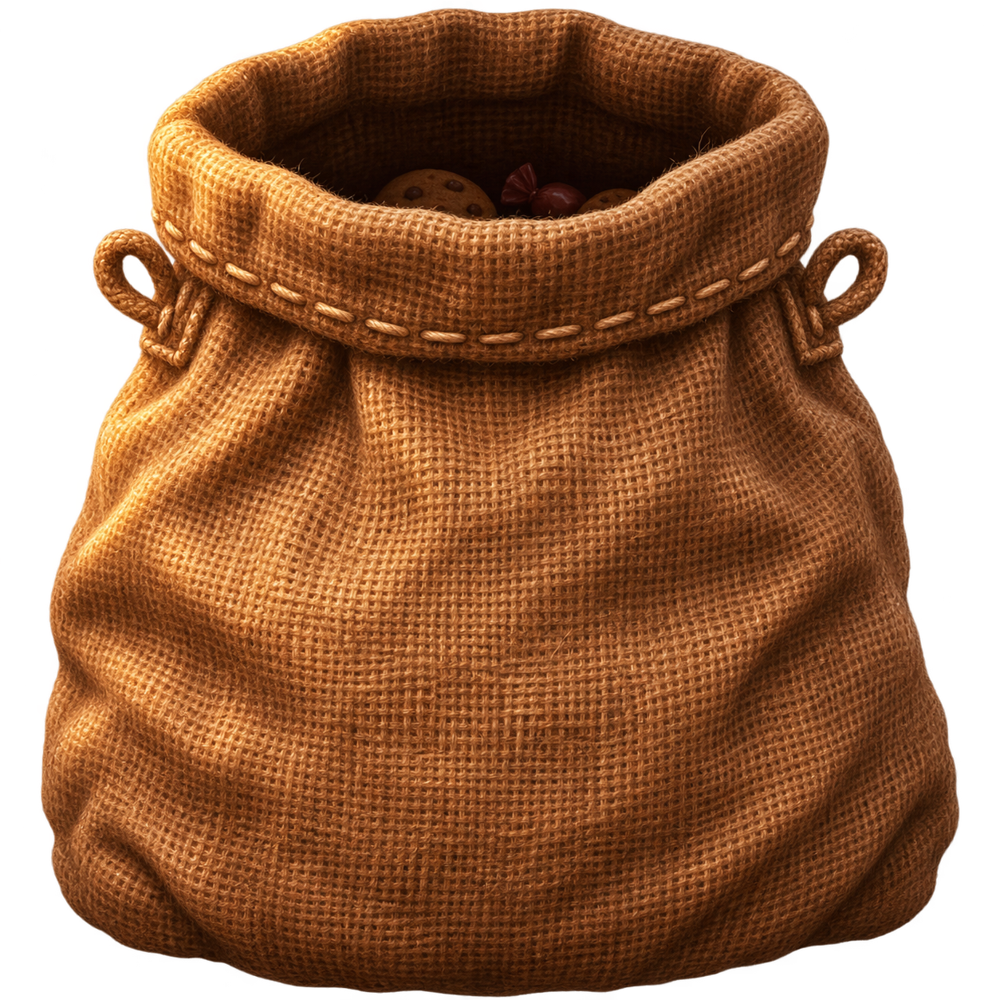

# GoodGPT



Мешочек с угощениями для **Codex (ChatGPT)** и **Claude Code в приложении Claude**. Схватите его, потяните вниз и переверните. Печенье и конфеты посыплются поверх чата, а после восьми угощений GoodGPT сразу попробует отправить одну фразу похвалы в текущий диалог.

Есть приложения для **Windows, macOS и Linux**. Дополнительно поставляется расширение для сайта ChatGPT в Chrome и Edge. Без аккаунта GoodGPT, API-ключей и отдельного сервера.

## Скачать

| Версия | Файл |
| --- | --- |
| Windows 10 / 11 | [GoodGPT-Windows.exe](https://github.com/Runeree/GoodGPT/releases/latest/download/GoodGPT-Windows.exe) |
| macOS 12 и новее | [GoodGPT-macOS.zip](https://github.com/Runeree/GoodGPT/releases/latest/download/GoodGPT-macOS.zip) |
| Linux: Ubuntu / Debian, X11 | [GoodGPT-Linux.deb](https://github.com/Runeree/GoodGPT/releases/latest/download/GoodGPT-Linux.deb) |
| Chrome / Edge / Chromium | [GoodGPT-Chrome.zip](https://github.com/Runeree/GoodGPT/releases/latest/download/GoodGPT-Chrome.zip) |
| Все версии с инструкциями | [GoodGPT-All.zip](https://github.com/Runeree/GoodGPT/releases/latest/download/GoodGPT-All.zip) |

[Страница релиза](https://github.com/Runeree/GoodGPT/releases/latest) · [Контрольные суммы](https://github.com/Runeree/GoodGPT/releases/latest/download/SHA256SUMS.txt)

## Windows

1. Скачайте `GoodGPT-Windows.exe` и запустите его. Устанавливать дополнительные программы не нужно.
2. Откройте нужный диалог в **Codex** или запустите **Claude** и выберите вкладку **Code**. Мешок появится поверх активного приложения.
3. Потяните мешок вниз и переверните, удерживая кнопку мыши.

Пауза, копирование последней похвалы и выход находятся в меню значка GoodGPT в системном трее. Файл переносимый, использует встроенный .NET Framework 4.8 и не подписан сертификатом издателя. [Подробная инструкция](desktop/windows/README.md).

## macOS

1. Скачайте и распакуйте `GoodGPT-macOS.zip`.
2. Перенесите `GoodGPT.app` в «Программы» и откройте.
3. В меню GoodGPT выберите **Разрешить управление приложениями**. Разрешите доступ в **Системные настройки → Конфиденциальность и безопасность → Универсальный доступ**. В списке процесс может называться `GoodGPT` или `osascript`.
4. Откройте нужный диалог в **Codex** или во вкладке **Code** приложения **Claude** и потяните мешок вниз.

Приложение не подписано и не прошло нотариальную проверку Apple. macOS может заблокировать первый запуск; действие **Открыть всё равно** находится в настройках безопасности. Сборка подготовлена в Windows, запуск на настоящем Mac пока не проверен. [Подробная инструкция](desktop/macos/README.md).

## Linux

Для Ubuntu 22.04 / 24.04 и Debian 12 / 13 есть **один установочный файл**. Нужен сеанс **X11** с композитным рабочим столом.

1. Скачайте [GoodGPT-Linux.deb](https://github.com/Runeree/GoodGPT/releases/latest/download/GoodGPT-Linux.deb).
2. Откройте терминал в папке с файлом и выполните:

```sh
sudo apt install ./GoodGPT-Linux.deb
```

3. Запустите **GoodGPT** из меню приложений или командой `goodgpt`.
4. Откройте нужный диалог и потяните мешок вниз. Колёсико или Shift с движением мыши переворачивают мешок. Правая кнопка на мешке открывает меню с паузой, состоянием отправки и выходом.

`apt` установит зависимости автоматически. Пакет подходит для x86_64 и ARM64 при наличии системных зависимостей. Для отправки нужен доступ к полю сообщения через **AT-SPI**. GoodGPT распознаёт доступные установленные сборки Codex/Claude и сайт ChatGPT в поддерживаемом браузере; сами Codex и Claude в пакет не входят. Готовая Linux-версия GoodGPT не означает, что существует официальная Linux-версия этих приложений.

**Wayland не поддерживается нативным приложением.** Для сайта ChatGPT используйте расширение Chrome/Edge из следующего раздела, оно работает и на Wayland. Для Fedora и Arch готового пакета пока нет. [Подробная инструкция Linux](desktop/linux/README.md).

Удаление: `sudo apt remove goodgpt`.

## Chrome и Edge

1. Скачайте `GoodGPT-Chrome.zip` и распакуйте в постоянную папку.
2. Откройте `chrome://extensions` или `edge://extensions`.
3. Включите **Режим разработчика**, нажмите **Загрузить распакованное расширение** и выберите папку с `manifest.json`.
4. Откройте [ChatGPT](https://chatgpt.com) и обновите уже открытые вкладки.

Расширение работает на сайте ChatGPT. Его меню позволяет скрыть мешок, вернуть его наверх и уменьшить движение. Папку расширения оставьте на диске. Одновременно с приложением для рабочего стола используйте одну версию GoodGPT, чтобы не видеть два мешка.

## Управление

| Действие | Как выполнить |
| --- | --- |
| Снять мешок с верёвок | Зажать левую кнопку и потянуть вниз |
| Переместить | Двигать мышь, удерживая мешок |
| Перевернуть | Крутить колёсико при удержании или двигать мышь с зажатым Shift |
| Высыпать | Направить горловину вниз; встряхивание увеличивает поток |
| Вернуть наверх | Отпустить мышь; в Windows/macOS доступен Escape, в Linux есть пункт меню мешка |

В расширении доступна клавиатура: Tab до мешка, пробел для снятия, стрелки для движения и вращения, Enter для отпускания.

## Отправка в чат

После восьми сладостей GoodGPT вводит похвалу в обычное поле сообщения и отправляет её без дополнительного подтверждения. За одно высыпание бывает одна попытка; формулировки меняются.

В Codex приложение нажимает Enter, затем находит новую строку очереди со своей похвалой и нажимает **Скорректировать / Steer**. В Windows предусмотрено распознавание поля на экране, когда приложение не предоставляет доступ к нему через UI Automation. Распознавание работает локально встроенными средствами Windows.

Конфеты, попавшие в поле ввода, сразу исчезают и удаляются из физики.

Похвалу можно отправить во время ответа ИИ. GoodGPT использует обычную отправку или кнопку очереди приложения. Если сайт ChatGPT временно отключает отправку, расширение сохраняет одну похвалу и отправляет её при доступности кнопки. Черновики и вложения не заменяются. После нажатия отправки автоматических повторов нет.

Возле мешка нет надписей, уведомлений и квадратной обводки. Управление находится в меню значка в трее Windows, строке меню macOS или по правой кнопке на мешке в Linux.

В Windows подсказка «Работайте с Codex / Work with Codex» отделяется от настоящего черновика. Мешок остаётся под управлением мыши во время высыпания и отправки. Резервный способ с кликом по полю ждёт отпускания мыши, не вырывая мешок из руки.

Приложения для рабочего стола распознают **Codex** и **Claude** через системные средства доступности: UI Automation в Windows, Accessibility в macOS и AT-SPI в Linux. Для Claude Code выберите вкладку **Code** и нужную сессию перед снятием мешка. GoodGPT отправляет сообщение в открытое поле диалога и не переключает вкладки за пользователя. Работа зависит от того, предоставляет ли конкретная версия приложения доступ к полю чата. Текст не вводится в редактор исходников. Приложение ChatGPT также распознаётся.

В Linux для вставки временно используется текстовый буфер обмена. Предыдущий текст восстанавливается, если пользователь не изменил буфер; форматирование не сохраняется. При нетекстовом содержимом буфера отправка отменяется. Кнопка Steer выбирается только у новой строки с собственной похвалой.

Проверки структуры пакетов и логики отправки включены в проект. Отправка в настоящие диалоги оставлена для ручной проверки. Изменения интерфейса Codex или Claude могут потребовать обновления адаптеров.

## Исходники и сборка

Нужен Node.js 22 или новее. Сторонних npm-зависимостей нет.

```sh
npm run build
npm run check
npm run desktop:linux
```

В Windows:

```powershell
npm run package
npm run desktop:windows
npm run desktop:macos
npm run desktop:linux
npm run desktop:check
powershell -NoProfile -ExecutionPolicy Bypass -File scripts/package-release.ps1
```

Расширение появится в `extension/`, приложения и общий архив в `dist/`. Команда `npm run dev` запускает локальный стенд на `http://127.0.0.1:4173`.

| Папка | Содержимое |
| --- | --- |
| `assets/` | Мешок, сладости и иконки |
| `src/` | Расширение, физика и отправка через интерфейс ChatGPT |
| `desktop/` | Приложения Windows, macOS и Linux, инструкции и упаковка |
| `scripts/` | Сборка и проверки |
| `tests/` | Локальный стенд чата |

## Приватность и лицензия

Телеметрии, серверов GoodGPT и API-ключей нет. Изображения входят в пакет, настройки расширения хранятся локально. Расширение запрашивает только `storage` и работает на `chatgpt.com` и `chat.openai.com`.

Похвала остаётся обычным сообщением в текущем диалоге и не меняет веса модели. Проект неофициальный, не связан с OpenAI или Anthropic.

Автор: [Runeree](https://github.com/Runeree). Код: [MIT](LICENSE). Описание графики: [assets/README.md](assets/README.md).
